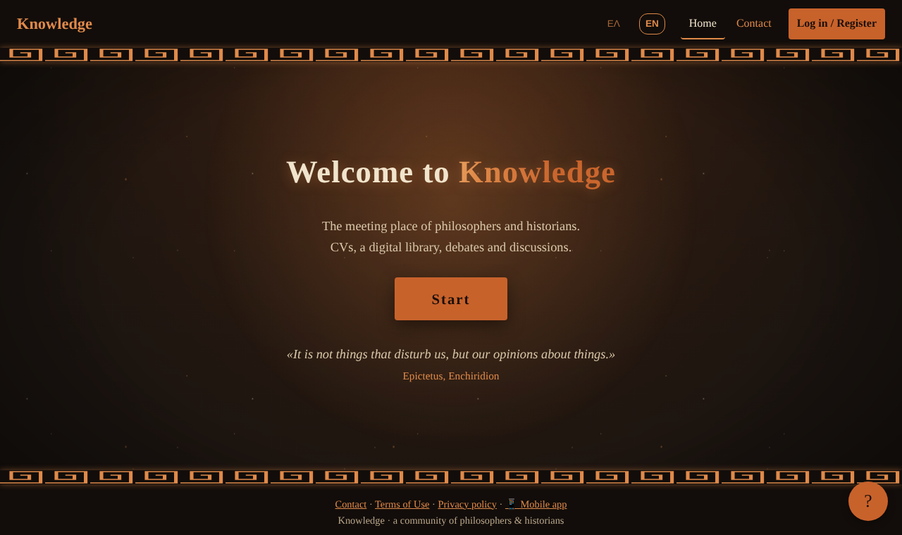
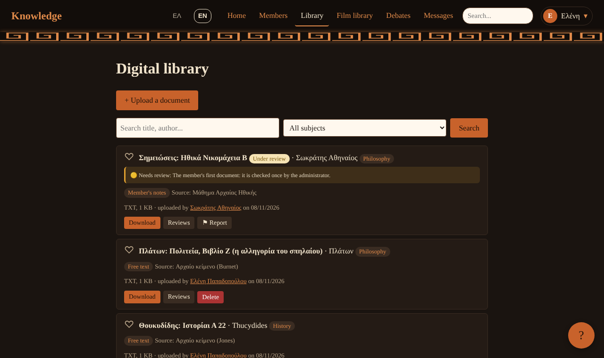
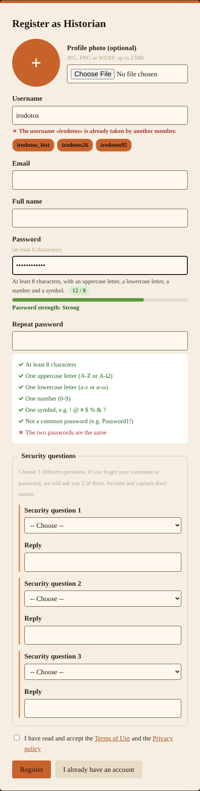
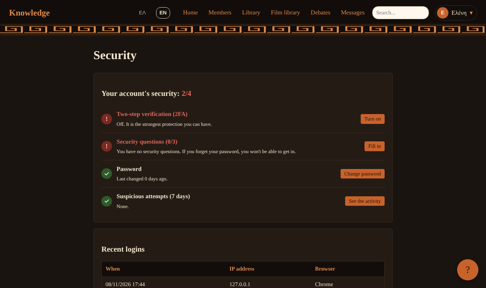
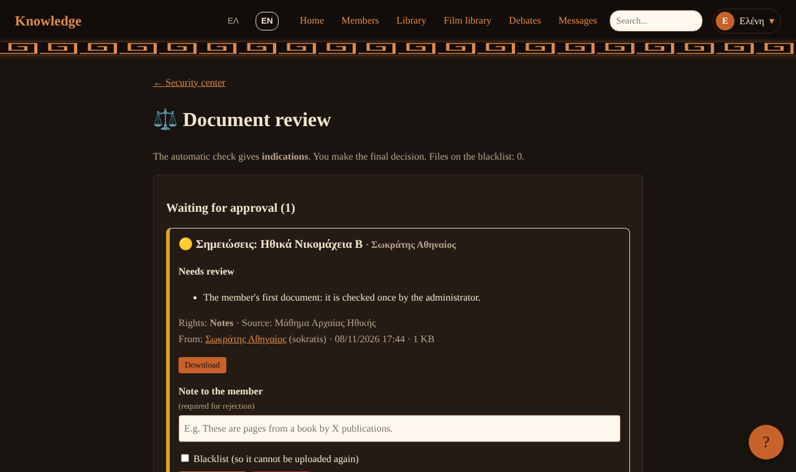
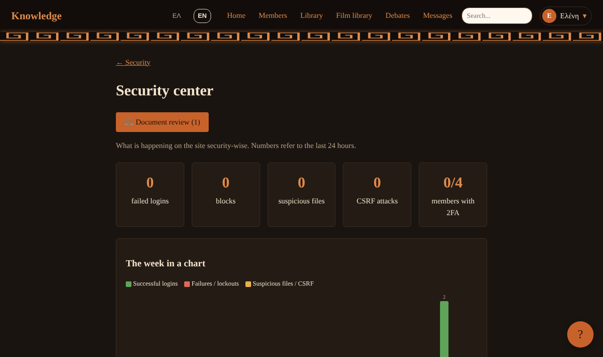

<div align="center">

# 🏛️ Knowledge

**A secure community platform for philosophers and historians**: digital library, structured debates,
private messaging and CVs, with a security-first design and a built-in copyright check for every upload.

*Πλατφόρμα για φιλοσόφους και ιστορικούς: ψηφιακή βιβλιοθήκη, debates, μηνύματα, βιογραφικά. Ελληνικά / English.*


**[Live demo](https://knowledge-library-akhpcyc9aybhb9av.swedencentral-01.azurewebsites.net)** ·
**[Security model](SECURITY.md)** ·
**[Changelog](CHANGELOG.md)**

</div>



## ✨ Features

| | |
|---|---|
| 📚 **Digital library** | Upload PDF, Word, ODT, EPUB, TXT and images. Reviews (1–5 ★), favourites, search across members, documents, films and debates, in-browser reading. |
| ⚖️ **Copyright check on every upload** | Detects ISBN/ISSN/DOI, © notices, publisher names, the EU *70 years after death* rule, duplicates and a blocklist. Low risk is published, the rest waits for an admin. "Report infringement" button on every document (EU DSA notice-and-action). |
| 💬 **Debates** | Questions with *for / against / neutral* arguments, "Agree" votes and a "most convincing" highlight. |
| ✉️ **Private messages** | With safe link detection: `http`, IP addresses, URL shorteners, look-alike (punycode) domains and `.exe` links are blocked. |
| 🎬 **Film library** | Uploaded videos (with HTTP Range streaming) or privacy-friendly YouTube embeds. |
| 📱 **Installable app (PWA)** | Home-screen icon, offline page, and a **document scanner**: perspective correction, "photocopy" filter and multi-page PDF, all on the device. |
| 🇬🇷 🇬🇧 **Greek / English** | One switch for the whole interface. Members' own texts are never machine-altered. |



## 🔐 Security highlights

Full threat model and OWASP Top 10 mapping: **[SECURITY.md](SECURITY.md)**.

- **Authentication:** bcrypt passwords with live strength meter and common-password blocklist · email verification (6-digit codes, hashed, 10 min, 5 tries) · **TOTP two-step verification** · per-device **PIN quick login** bound to a device secret · **3 security questions** (2 random ones asked) for recovery.
- **Brute force:** lockout by IP (5 / 15 min) **and** by account (10 / 15 min from any IP) · rate limits on email codes, username checks, reports · **Cloudflare Turnstile** on login, register, recovery and contact.
- **Sessions:** HttpOnly + SameSite + Secure cookies · ID regeneration on login · 30-minute idle timeout · **password change signs out every other device** (session versioning).
- **Injection & XSS:** PDO prepared statements everywhere (emulation off) · context-aware output escaping · Content-Security-Policy, `X-Frame-Options`, `nosniff`, HSTS.
- **CSRF:** token on every state-changing form, including logout.
- **Access control:** server-side ownership checks against IDOR · admin pages re-ask the password after a PIN login.
- **Files:** extension allow-list **and** real content type (`finfo`) **and** image decoding · random file names · stored **outside the web root** · served by scripts with `nosniff` and a CSP `sandbox`.
- **Privacy:** no user enumeration in login, registration or recovery · security log with an admin **Security Center** (7-day chart, locked IPs, suspicious IPs).

<table>
<tr>
<td></td>
<td></td>
</tr>
<tr>
<td align="center"><sub>Live username availability and password strength</sub></td>
<td align="center"><sub>Personal security checklist</sub></td>
</tr>
<tr>
<td></td>
<td></td>
</tr>
<tr>
<td align="center"><sub>Admin review queue for uploads</sub></td>
<td align="center"><sub>Security Center</sub></td>
</tr>
</table>

## 🧱 Tech stack and architecture

**PHP 8.3** (no framework, on purpose: every security control is visible in the code) · **MySQL 8 / MariaDB** · vanilla **JavaScript** · **Azure App Service** (Linux, nginx) + **Azure Database for MySQL Flexible Server** · **Brevo** (transactional email) · **Cloudflare Turnstile**.

```
knowledge/
├── public/          ← the ONLY folder reachable from the web (pages, CSS, JS, icons)
├── src/             ← bootstrap (headers, session, .env), database, helpers, i18n
│   └── lang/        ← English dictionary
├── templates/       ← header, footer, shared partials
├── storage/         ← uploads, photos, videos (local only, git-ignored)
├── migrations/      ← 001_initial_schema.sql, upgrades/, demo_seed.sql
├── deploy/          ← Azure nginx config, startup script, zip builder
└── docs/            ← screenshots
```

## 🚀 Run it locally

**Requirements:** PHP 8.1+ (with `pdo_mysql`, `fileinfo`, `mbstring`, `curl`, `zip`) and MySQL 8 or MariaDB 10.6+.

```bash
git clone https://github.com/<your-account>/knowledge.git
cd knowledge
cp .env.example .env                        # edit DB_USER / DB_PASS
mysql -u root -p < migrations/001_initial_schema.sql
mysql -u root -p knowledgebase < migrations/demo_seed.sql   # optional demo data
php -S localhost:8000 -t public
```

Open <http://localhost:8000>. Demo accounts (after `demo_seed.sql`): `demo_admin`, `sokratis`, `irodotos`, `ypatia`. Password: `Demo#Knowledge2026`.
In development (`APP_ENV=development`) email codes are shown on screen, so no mail service is needed.

**XAMPP:** copy the folder to `htdocs/knowledgebase`. The root `.htaccess` serves only `public/`.

## ☁️ Deploy to Azure

Step-by-step guide: **[deploy/azure/README.md](deploy/azure/README.md)**. In short: MySQL Flexible Server (B1ms) → App Service (Linux, PHP 8.3) → environment variables → `deploy/build-zip.sh` → `az webapp deploy`.

## 🗺️ Roadmap

- [ ] Split `src/functions.php` into modules and add PHPUnit tests
- [ ] GitHub Actions: tests, PHPStan, CodeQL
- [ ] Docker Compose (`docker compose up`)
- [ ] Strict CSP with nonces (remove `unsafe-inline`)
- [ ] TOTP backup codes · block users · report debate posts · CSV export of the security log

## 👥 Authors

- **[Friend's name]**: idea, content, history and philosophy expertise, testing
- **[Your name]**: development, security, Azure deployment

Built with AI assistance (Anthropic Claude). Architecture, security design, testing and deployment were reviewed and carried out by the authors.

## 📄 License

[MIT](LICENSE)
